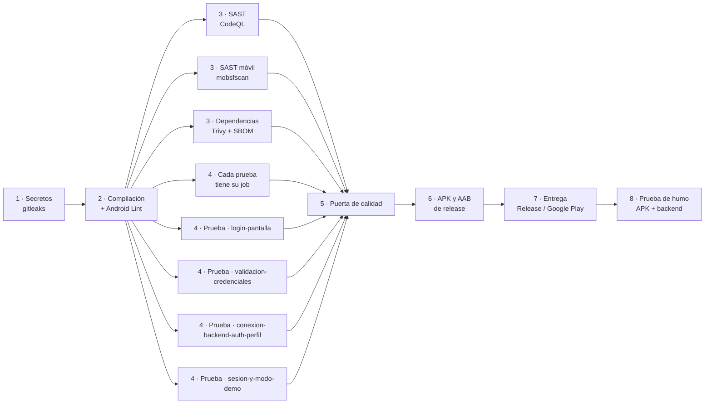

# CI/CD DevSecOps de la app

Un solo workflow (`.github/workflows/pipeline.yml`, nombre **CI/CD DevSecOps**) con jobs encadenados por `needs:`.
Es el mismo flujo que el del backend, adaptado a Android: en la pestaña **Actions** se ve todo el camino del código,
desde los secretos hasta el APK y la entrega.

## Cuándo corre

| Evento | Qué hace |
|---|---|
| Pull request a `develop` o `main` | Etapas 1 a 6. Entrega y prueba de humo aparecen como *skipped* para que el diagrama muestre el flujo completo. |
| Push / merge a `main` | Todo, incluida la entrega de los artefactos y la prueba de humo. |
| Manual (Run workflow) desde `main` | Igual que push; con la casilla `create_release` además crea el GitHub Release `app-vX.Y.Z`. |

## Etapas

| Etapa | Herramienta | DevSecOps | Bloquea |
|---|---|---|---|
| 1 · Secretos | gitleaks (repo e historial) | Detección de secretos | Sí |
| 2 · Compilación y Android Lint | Gradle + Lint | SAST de Android (permisos, seguridad, APIs) | Sí |
| 3 · SAST (CodeQL) | CodeQL java-kotlin | SAST | No (repo privado sin Advanced Security) |
| 3 · SAST móvil | mobsfscan (reglas OWASP MASVS) | SAST móvil | Sí, solo severidad ERROR |
| 3 · Dependencias y SBOM | Trivy sobre `gradle.lockfile` de release + Syft (SPDX) | SCA y cadena de suministro | Sí, HIGH y CRITICAL |
| 4 · Cada prueba tiene su job | `scripts/ci/check-test-matrix.sh` | Trazabilidad de pruebas | Sí |
| 4 · Prueba · *funcionalidad* | `testDebugUnitTest --tests` (matriz) | Pruebas | Sí |
| 5 · Puerta de calidad | Resumen etapa → resultado | — | Sí, si una bloqueante falló |
| 6 · APK y AAB de release | R8 + recursos reducidos, SHA-256 | Integridad del artefacto | Sí |
| 7 · Entrega | GitHub Release (manual) y Google Play interna (si hay llaves) | Publicación controlada | — |
| 8 · Prueba de humo | apkanalyzer + `health/ready` del backend | Verificación posterior | Sí |

## Pruebas por funcionalidad

Cada clase de prueba es un job de la matriz `feature-tests`, todos al mismo nivel:

| Job | Clase |
|---|---|
| login-pantalla | `ui.auth.LoginViewModelTest` |
| validacion-credenciales | `domain.usecase.ValidateCredentialsUseCaseTest` |
| conexion-backend-auth-perfil | `data.repository.AuthRepositoryImplTest` (registro, login, refresh y perfil contra un servidor simulado) |
| sesion-y-modo-demo | `data.repository.FakeAuthRepositoryTest` |

Al crear una clase de prueba nueva hay que agregarla a la matriz; si no, falla `4 · Cada prueba tiene su job`.

## Configuración del repositorio

| Nombre | Tipo | Para qué |
|---|---|---|
| `API_BASE_URL` | Variable | URL del backend para el build de release; https y termina en `/api/v1/`. |
| `CODEQL_DISABLED` | Variable (opcional) | `true` apaga CodeQL. |
| `PETMATE_KEYSTORE_BASE64`, `PETMATE_STORE_PASSWORD`, `PETMATE_KEY_ALIAS`, `PETMATE_KEY_PASSWORD` | Secretos (opcionales) | Firmar el APK/AAB. Sin ellos salen sin firmar. |
| `PLAY_SERVICE_ACCOUNT_JSON` | Secreto (opcional) | Subir el AAB firmado a la pista interna de Google Play. |

Los secretos los crea una persona con `gh secret set`; nunca se escriben en el repositorio (constitution.md P6).
